# VoxelEngine

A voxel game set entirely underground, written in C++20 with OpenGL. The idea is to head out from a cave village, find ore and loot, then come home to upgrade your gear. Deeper expeditions will lead to different cave worlds.

It's still early. You can explore the village, build and play your own levels, mine ore, fight encounters, collect loot, and upgrade tools and armor at the village workshops. Procedural expeditions and the central tree's skill tree aren't built yet.

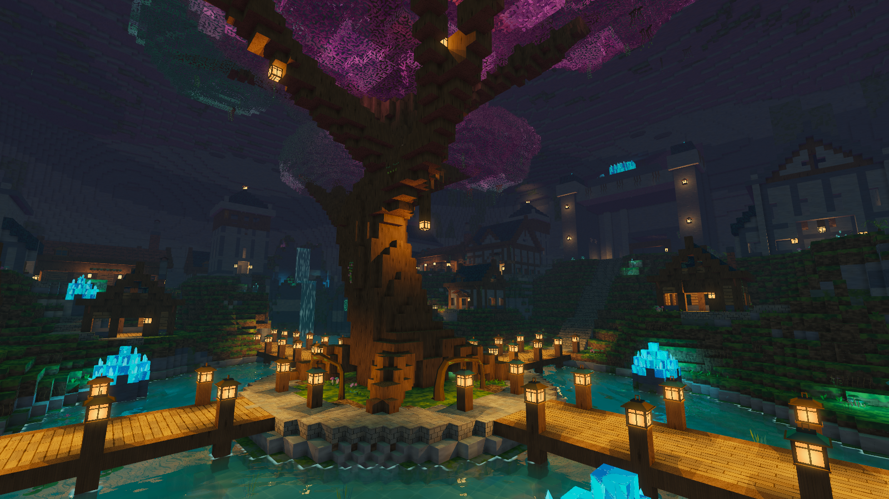

## Build and run

You'll need a C++20 compiler, CMake 3.20 or newer, and a display with OpenGL 4.1 support.

On macOS, install the dependencies with Homebrew:

```sh
brew install cmake glfw glew glm
```

On Ubuntu:

```sh
sudo apt-get update
sudo apt-get install -y build-essential cmake libglfw3-dev libglew-dev libglm-dev libopenal-dev libgl1-mesa-dev
```

Then, from the repo folder:

```sh
cmake -S . -B build -DCMAKE_BUILD_TYPE=Release
cmake --build build --parallel
./build/VoxelEngine
```

After pulling changes, run the build command again. `./build/VoxelEngine --help` lists the launch options.

Encounter starts have a positional chime when OpenAL is available. macOS includes it; the Ubuntu command above installs it. The game also builds and runs without audio.

## Playing

You start in the village. The blacksmith is southwest of the central tree, marked with an anvil sign. The armory is the neighboring building to its east, with a shield sign and armor displays. The expedition gate is to the north.

| Control | Action |
| --- | --- |
| WASD / mouse | Move / look |
| Space / Shift | Jump / sprint |
| Space / Ctrl in water | Swim up / dive |
| 1–4 or mouse wheel | Select pickaxe, lantern, compass, or sword |
| Hold left click with pickaxe | Mine the ore block you're aiming at |
| Left click with sword | Swing at the enemy you're aiming at |
| E | Use a nearby chest, workshop, or expedition gate |
| I | Open the 20-slot inventory |
| R | Return to the village spawn, or the current expedition checkpoint |
| Escape / Tab | Pause / resume |
| H / Q | Toggle controls / quit |

You walk up stairs automatically. Full blocks need a jump. Select the lantern with **2** to carry it in your hand; its glowing cage sways gently and lights your surroundings. Press **3** to hold the brass compass. Its red needle turns toward the current section's End as you move and look around, and updates when the next section loads. It works in **F8** playtests too; in the village it points toward the central tree.

The HUD keeps your tools and health at the bottom. Mining, chest, and interaction prompts appear when needed. Press **H** for controls, including during section playtests.

You have 100 health. Enemy hits give you a short shove and view jolt, with a red edge pulse showing where the hit came from. Long falls deal damage and trigger the pulse without a sideways shove; landing in water cushions the fall. If you die, you return at full health to the checkpoint you reached, or the current section's Start. Your inventory and collected loot stay as they were. Health carries over when you move to the next section, but checkpoints belong to their own section.

Standalone spawners and the first fight in a chain wake when you approach. Linked spawners run in order: clearing one starts the next after two seconds, with rewards set separately for each fight. Skeletons chase and slash, slimes pounce, and wizards fire slow spells you can dodge. Select the sword with **4**, aim at a nearby enemy, and left click to attack. Hits knock enemies back, briefly flash their bodies, and scatter bone chips, magic shards, or slime droplets. A hit also reveals the enemy's health bar and interrupts its attack. Defeat every enemy from a spawner to release its rewards; clear every spawner in the section to open the exit.

Completed spawners stay cleared, even after closing the game. Uncollected rewards wait beside them on your next visit. Dying or pressing **R** resets unfinished encounters, while cleared spawners and collected loot stay as they were. After a reset or another visit, approach the first unfinished spawner to resume its chain.

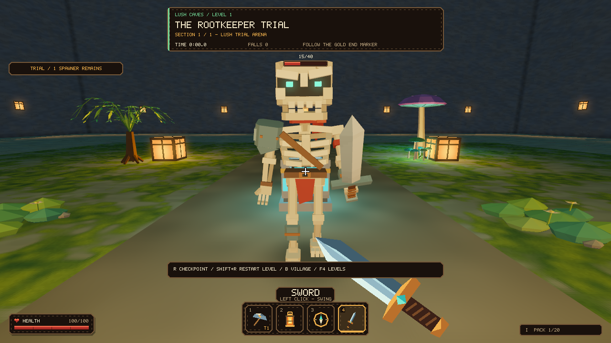

Chests and floating drops provide resources. Ironbound chests need a cave key, and keys only work within the section where you found them. Collected loot stays collected when you replay a section. Unused keys return to their source when you leave and come back.

Press **F4** to choose a published level, or **F6** to try the ten built-in Root Crossing parkour rooms. A fresh checkout won't have any published levels: those are made locally with the builders below. On a Mac, you may need to hold **Fn** for the function keys.

## Mining

Select the pickaxe with **1** and hold left click on a nearby ore block. The pickaxe swings in your hand while the meter fills. Releasing the button or aiming away starts the work over. Broken ore drops one matching resource; walk over it to pull it into your bag. A full bag leaves it on the ground.

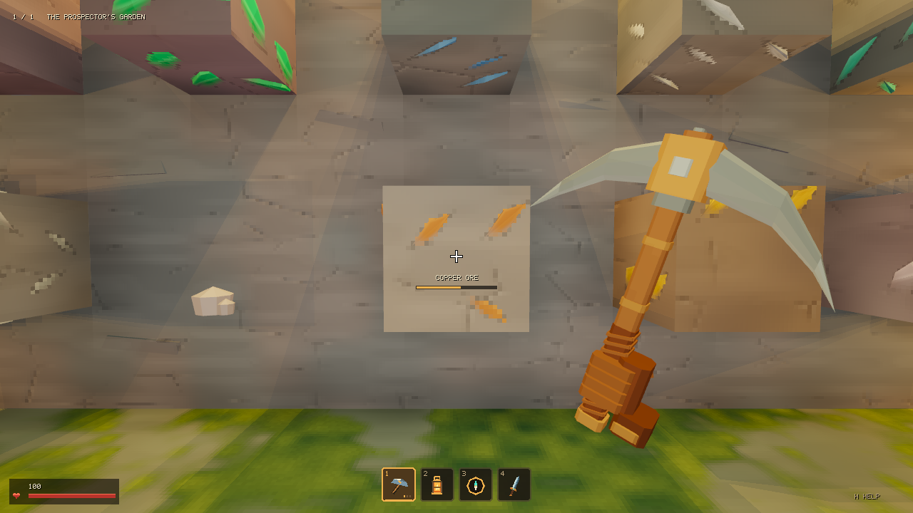

All 18 resources have source blocks in the creative menu. Place them in a section, then press **F8** to try mining. A pickaxe mines its own material and every material below it in the upgrade order. Each upgrade also speeds up mining. New players start with Coal tools and 12 coal, enough for the first tool upgrade.

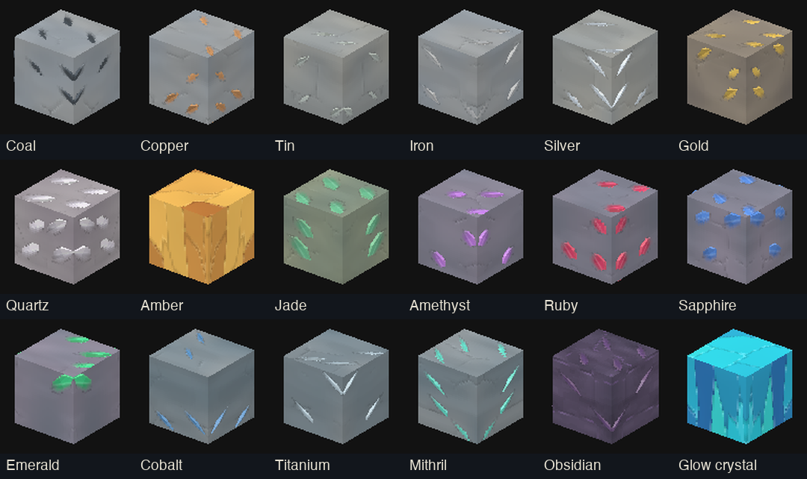

Mined blocks stay gone when you revisit a published section, and uncollected drops wait there for you. F8 tests use temporary terrain and loot: returning to the builder restores the blocks, and a fresh test starts over. Mining works in authored sections; village scenery and ordinary building blocks stay intact.

## Tools and armor

The blacksmith upgrades your **pickaxe** and **sword**. The **armory**, next door to the east, makes and upgrades **helmets, chestplates, leggings, and boots**. Approach the fitting bench and press **E**. Use **1–4** or the **arrow keys** to select a piece, **Enter** to buy, and **E / Escape** to close.

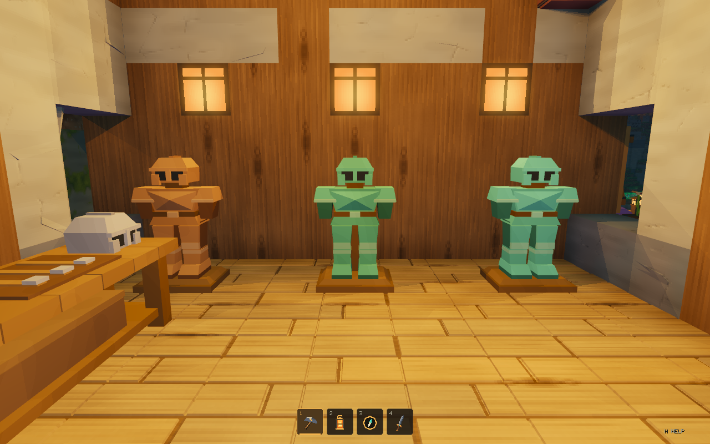

Each piece upgrades separately and equips immediately. Open **I** to see your four armor slots and total protection beside the 20-slot bag. Each material tier adds 1% combat protection per armor piece, up to 72% with a full final-tier set. It does not protect against falls or falling out of a section. Better swords deal more damage; boots have no jump ability yet.

Every ore has a tool and armor tier. The current order is:

Coal → Copper → Tin → Iron → Quartz → Amber → Silver → Gold → Jade → Amethyst → Obsidian → Cobalt → Titanium → Ruby → Sapphire → Emerald → Mithril → Glow Crystal.

Every upgrade costs **10 of the current material**: Copper to Tin costs 10 copper, for example. An empty armor slot costs 10 coal to make its first Coal piece. The menu shows the next piece, its benefit, the cost, and how much ore you have. Costs and order live together in `src/equipment.cpp` for later balancing.

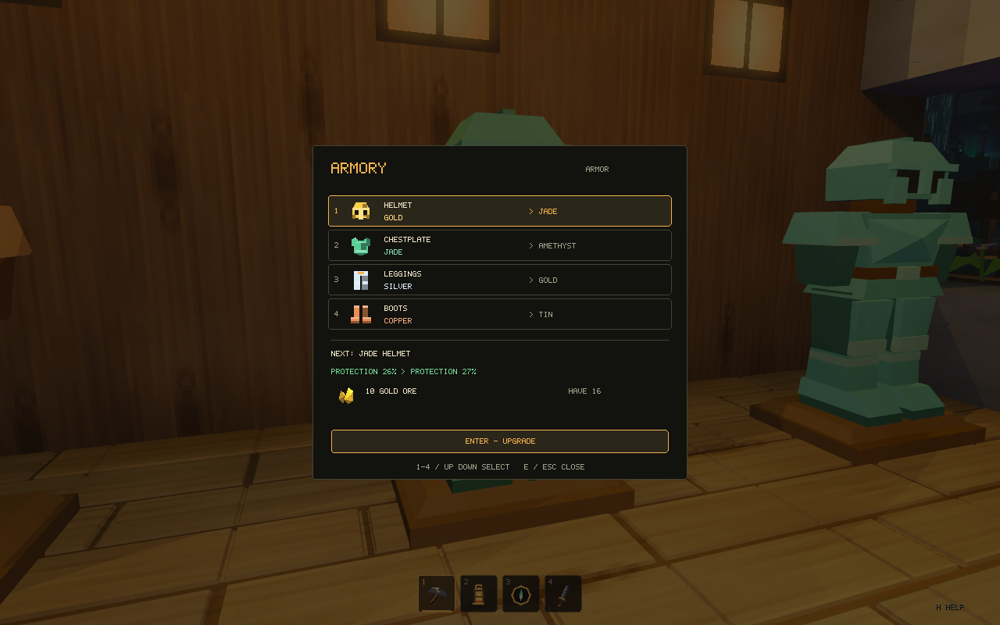

Purchases save immediately. Older profiles retain their inventory, collected loot, and access to previously mineable ores when converted to the new gear tiers. Section playtests restore your real equipment when you return to building.

## Creature preview

Press **F3** in the village, or run `./build/VoxelEngine --monsters`. The grotto has a skeleton swordsman, a cave wizard, and a hopping slime. Walk around them to inspect the models and animations.

**1** plays idle, **2** plays walk/hop cycles in place, **3** plays attacks, and **E** cycles through all three. **R** resets the view; **B** or **F3** returns to the village. Escape pauses the animations along with the game.

The preview is for inspecting animations. To fight these creatures, place a Trial spawner in a section and use **F8** to test it, or play a published level containing one.

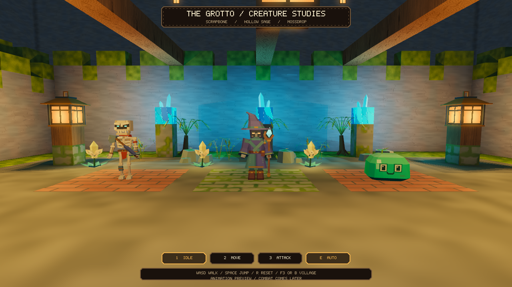

## Building sections and levels

Start the section builder with **F7**, or launch it directly:

```sh
./build/VoxelEngine --dev
```

1. Choose a world, then **Parkour** for an open room, **Cave exploration** for a filled cave to carve, or **Arena** for a ready-to-edit fighting space. Pick a preset and click **Create**. All three use a 64 × 48 × 64 building area inside a protected shell.
2. Press **E** to choose blocks, models, items, and markers. Left click removes, right click places, and middle click picks what you're looking at. **T** rotates pieces; **Y** changes model finishes or gate pose.
3. Place one **Start** and one **End** marker. You can add a checkpoint too.
4. Press **F8** to walk through the room. Reach the End, then press **F8** to return to building.
5. Press **F10** to name the section, choose its category, and accept it. Editing it again means testing it again.
6. Open the level creator with **F11**. Add accepted sections in order, give the level a name and number, and click **Publish**. It will appear in the **F4** level picker.

Each world has a starting preset: **Root jungle** mixes dirt, moss, stone, and roots; **Crystal grotto** uses pale rock and mineral seams; **Ember rock** has dark slate, obsidian, and clay. The cave fill carries these materials throughout, including passages you dig later. Choose **Plain stone** for a blank canvas. Existing sections keep their terrain.

Lush Caves also has 16 overgrown models in **E → Assets**: broad-leaf plants, bamboo, hanging ferns, pitcher plants, roots, mossy platforms, and ruined stonework. Their leaves, bark, moss, and chipped edges use actual 3D geometry. The [building guide](docs/building.md#overgrown-cave-kit) shows the full kit and how to place it.

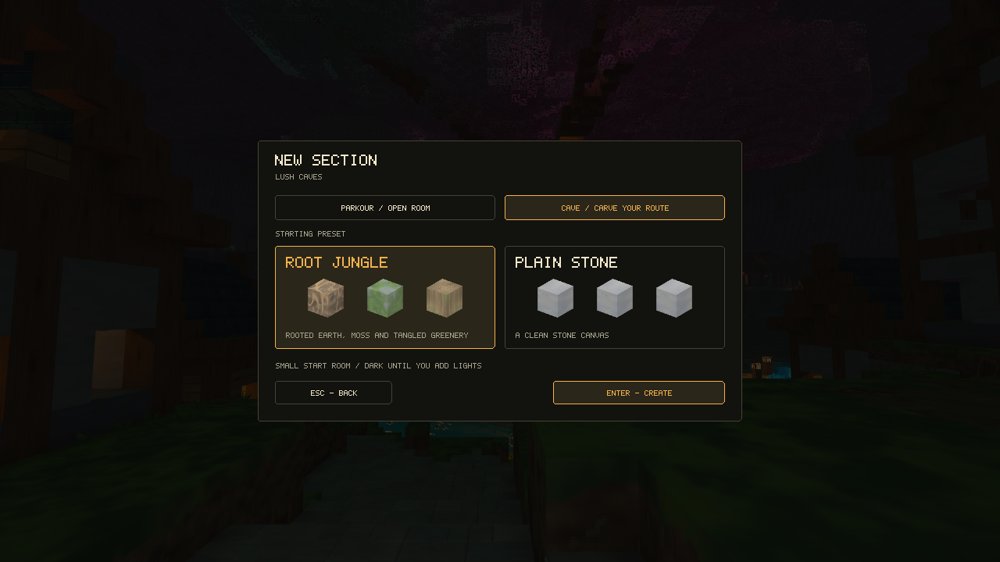

Menus share a simpler cave palette, and the builder keeps only a small status label, hotbar, and contextual hint on screen. Press **H** for the full controls.

Name a draft at any time with **F2** or **G → Rename section**. Type a name and press **Enter** to save; **Escape** cancels. You don't need to finish a playtest first.

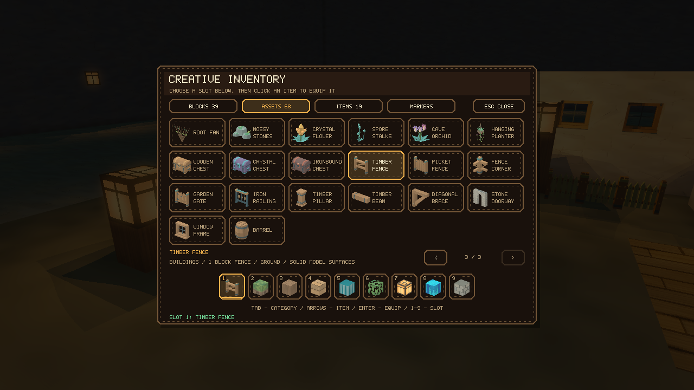

**G** opens the faster building tools: area selection, fill, shell, cube brush, and copy/paste. **X** dismisses the paste preview and returns to normal building. **F5** saves a draft; changed work also autosaves. **F9** opens the section library.

Caves start with **Round carve** selected. Hold left click to dig; **E → Tools** also has a box carve, and **G** sets the brush width. Press **X** to switch back to placing blocks and models.

Dark caves rely on lamps, glowing materials, or your equipped lantern. The builder has a temporary light you can turn off with **G → Build light**; F8 tests always use the section's saved lighting. Existing sections and the village keep their usual lighting.

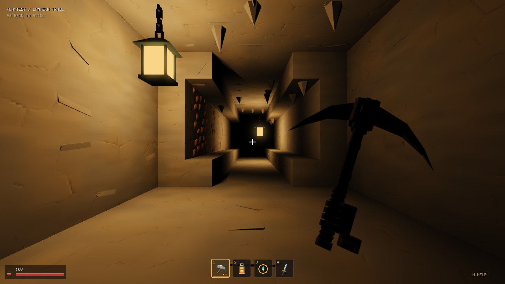

To chain fights, place Trial spawners, aim at the first, and choose **E → Link next**. Click the next spawner, then **Save**. Repeat for later fights; numbered arrows show their order while building. **Unlink** removes a connection, and **X / Escape** cancels target selection. Chains stay within one section. The [building guide](docs/building.md#chain-spawners) covers chaining, building tools, and loot.

**Arena** starts with three linked waves, cover, raised side platforms with stairs, and placed lights. Each spawner pays out its own loot when cleared. Aim at one and press **E** to change enemies, links, or **Edit rewards**; give the last fight better loot if you want. Clear every spawner to unlock End. **F8** tests it, and an accepted arena can be added to a level alongside your other sections.

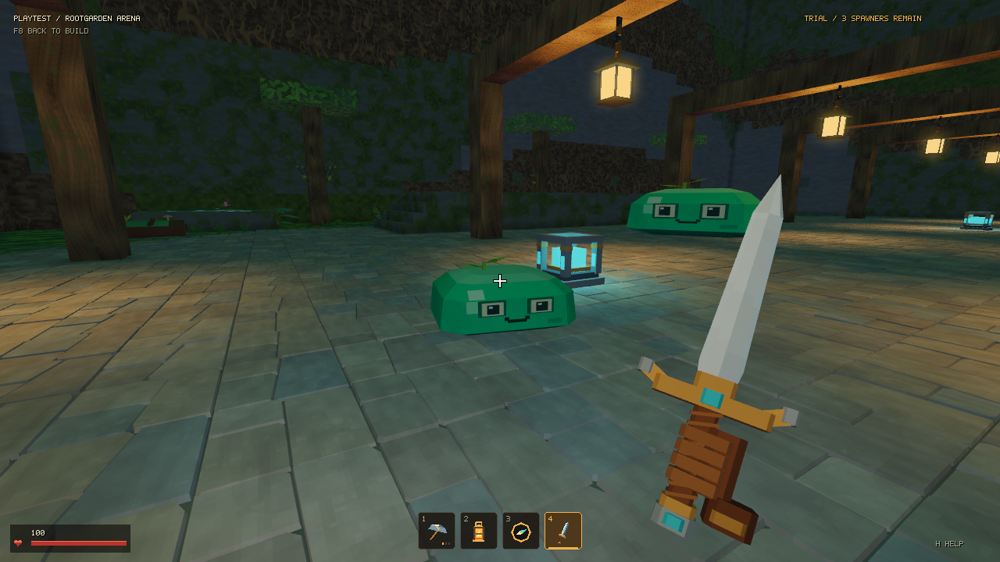

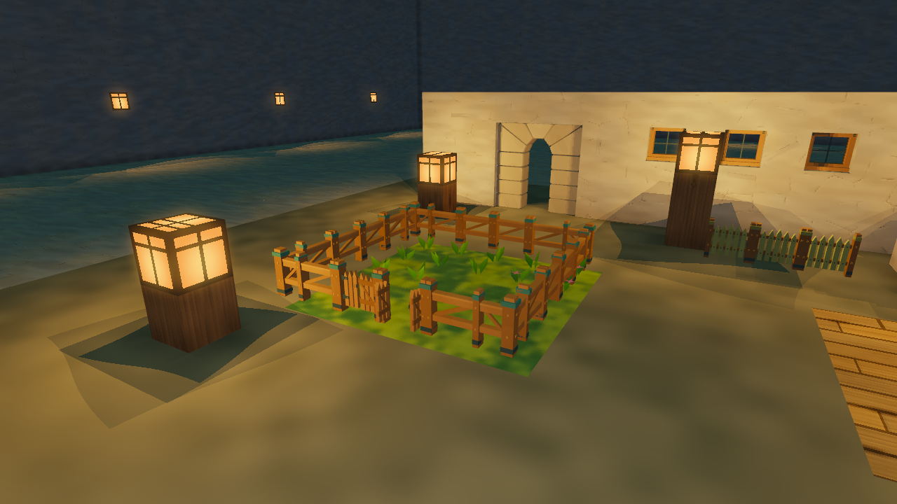

Building pieces in a test room. Fences and railings fit one-block cells; the doorway fits a three-by-three wall opening.

Stairs share their full blocks' surface details, including raised paving, brickwork, board edges, and chipped rock. Ore veins and crystal facets catch the same lights as the surrounding cave.

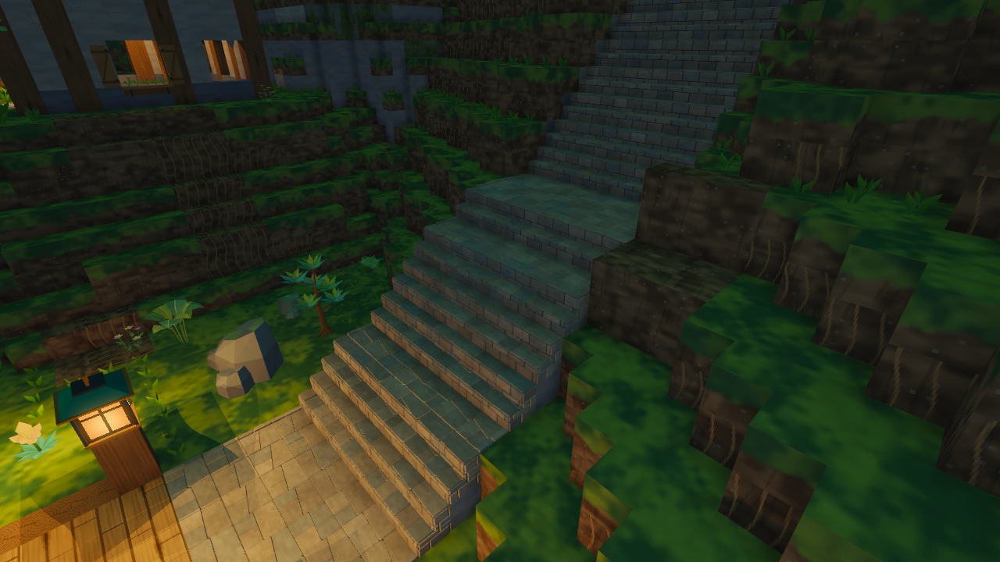

The older terrain sandbox is still available with `./build/VoxelEngine --editor`. It uses manual **F5** saving and **F9** loading, and is separate from the section builder.

## Saves

Files are stored relative to the folder you launch the game from. Run it from the repo folder to keep them together.

| Location | Contents |
| --- | --- |
| `progress.vxp` | Inventory, equipped tools and armor, mined ore, collected loot, and unlocked chests |
| `sections/` | Section drafts and accepted rooms |
| `levels/` | Level drafts and published section orders |
| `world.vxl` | The older terrain editor's world |

These files are ignored by Git. Back up `sections/` and `levels/` together: a level references its section files. The village terrain resets on launch, while your saved inventory and upgrades remain. Section playtests use temporary loot and terrain, restoring your real inventory and authored blocks afterward.

## Working on the code

The main loop in [src/main.cpp](src/main.cpp) reads input, updates the game, and draws a frame.

| Area | Start here |
| --- | --- |
| Game modes and input | [game.cpp](src/game.cpp), [input.cpp](src/input.cpp) |
| Creature rigs and animation | [monsters.cpp](src/monsters.cpp), [monster_preview.cpp](src/monster_preview.cpp), [monster_skeleton.cpp](src/graphics/monster_skeleton.cpp) |
| Movement and collision | [player.cpp](src/player.cpp), [asset_collision.cpp](src/asset_collision.cpp) |
| Health and respawning | [health.cpp](src/health.cpp), [game_health.cpp](src/game_health.cpp) |
| Spawners and combat | [encounters.cpp](src/encounters.cpp), [spawner_chains.cpp](src/spawner_chains.cpp), [game_combat.cpp](src/game_combat.cpp), [spawner_loot.cpp](src/spawner_loot.cpp) |
| Equipment and workshops | [equipment.cpp](src/equipment.cpp), [game_equipment.cpp](src/game_equipment.cpp) |
| Pickaxe and mining | [mining.cpp](src/mining.cpp), [ores.cpp](src/ores.cpp), [game_mining.cpp](src/game_mining.cpp), [mining_loot.cpp](src/mining_loot.cpp) |
| Village layout and buildings | [scene.cpp](src/scene.cpp), [hub_buildings.cpp](src/hub_buildings.cpp) |
| Blocks and chunk meshes | [world.h](src/world.h), [mesh.cpp](src/mesh.cpp) |
| Building tools and section files | [section_editor.cpp](src/section_editor.cpp), [section_tools.cpp](src/section_tools.cpp), [sections.cpp](src/sections.cpp) |
| Level creation and playback | [level_editor.cpp](src/level_editor.cpp), [levels.cpp](src/levels.cpp) |
| Items, inventory, and loot | [items.cpp](src/items.cpp), [inventory.cpp](src/inventory.cpp), [loot.cpp](src/loot.cpp) |
| Rendering, materials, models, and UI | [src/graphics/](src/graphics/) |

Run the CPU tests with:

```sh
ctest --test-dir build --output-on-failure
```

The graphics check opens a hidden window and still needs a working OpenGL context:

```sh
./build/VoxelEngine --smoke-test
```

To work on the core without the graphics dependencies, build with only CMake, a C++20 compiler, and GLM:

```sh
cmake -S . -B build-core -DVOXEL_BUILD_APP=OFF -DCMAKE_BUILD_TYPE=Debug
cmake --build build-core --parallel
ctest --test-dir build-core --output-on-failure
```
