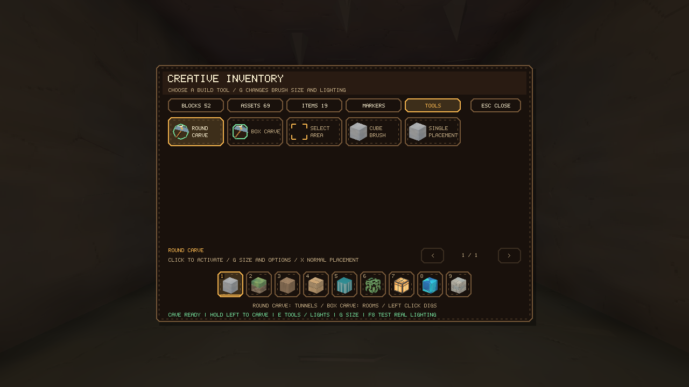
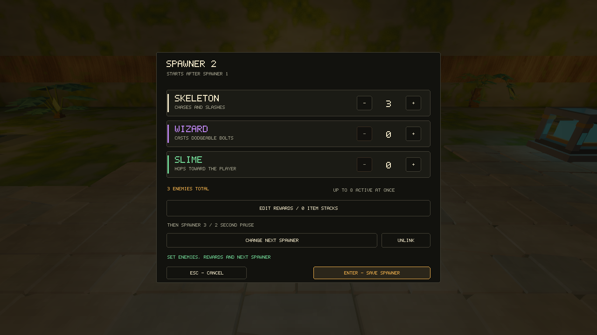

# Building sections

Open the builder with **F7** or `./build/VoxelEngine --dev`. Choose a world, then create a new section or open a draft. These instructions are for the section builder; `--editor` opens the older terrain sandbox.

Choose **Parkour** for an open room or **Cave exploration** for a solid volume to carve. The next screen lets you choose the world's preset or **Plain stone**, then **Create**. You can also change the layout on that screen. Arrow left/right changes layout, up/down changes preset, and Enter creates it; Escape goes back.

| World | Preset | Materials |
| --- | --- | --- |
| Lush Caves | Root jungle | Rooted dirt, stone, moss, winding roots, and greenery |
| Crystal Hollows | Crystal grotto | Calcite, limestone, slate, quartz, and amethyst seams |
| Ember Depths | Ember rock | Slate, obsidian, stone, and warm clay bands |

Presets become ordinary blocks and models you can edit. Cave materials run throughout the solid volume, so digging new passages reveals the same theme. Parkour scenery stays around the edges, leaving room for your route. **Plain stone** keeps the original unadorned starting layout. Choosing a preset only affects a new section; saved drafts and accepted sections keep their terrain.

The builder shows a small section label, hotbar, and the current tool's hint. Routine messages fade after a few seconds. **H** opens the full controls when you need them; **G** opens build settings.

Press **F2** while building, or choose **G → Rename section**, to name your section before testing it. Type the name and press **Enter** to save it with the draft; **Escape** cancels. Click the name field or use **Cmd/Ctrl+A** to replace the whole name. Renaming keeps your build and completed playtest intact. On a Mac, you may need **Fn+F2**.

## Carving a cave

Choose **Cave exploration**, pick a preset, then **Create**. The 64 × 48 × 64 building area starts filled with the preset's materials, with a small room around Start. It uses the Exploration category and dark lighting. The presets add no light sources to this room. **Parkour** creates the open room instead.

1. Hold **left click** on a wall to dig with **Round carve**. Move and aim as you dig to make passages and chambers.
2. Press **G** to choose a width of **1, 3, 5, or 9** blocks. **Round carve** makes rounded cuts; **Box carve** clears a cube. Both are also available in **E → Tools**.
3. Press **X** to return to normal placement. Add blocks, ores, water, greenery, and lights from the creative inventory. The Assets tab starts with **Lantern**, **Wall bracket**, **Hanging lamp**, and **Crystal beacon**. Glowing mushrooms and crystal flowers are light sources too.
4. Move **End** from its temporary spot in the starting room to the end of your route. Add a checkpoint if you want one.
5. Press **F8** to walk through it with the same lighting players get. **F8** returns to building; **F10** names and accepts a completed test.

Each carve stamp can be undone with **Cmd/Ctrl+Z**. A held click repeats stamps. Carving removes models anchored inside the cut as well as blocks; it leaves Start, End, and Checkpoint in place. Check their footing if you dig underneath them. The outer shell stays protected.

### Cave lighting

**G → Light: Dark** saves a section with no ambient light or invisible camera lamp. Without a light source, its stone, ordinary foliage, and water are black. Placed lamps illuminate nearby surfaces and stone walls block their light. Glowing blocks and plants remain visible as light sources.

**Build light: On** is temporary help for editing. Switch it off to preview your lighting while building. It never carries into **F8** tests or published levels. During play, select the lantern with **2** for personal light; select another tool to put it away.

You can switch any section between **Light: Dark** and **Light: Ambient**. That setting is saved with the section and follows it into assembled levels. Existing sections keep their original ambient lighting. Changing the setting requires another playtest before accepting.

## Moving and placing things

| Control | Action |
| --- | --- |
| WASD / mouse | Fly / look |
| Space / Ctrl | Fly up / down |
| Shift / Alt (Option) | Faster / slower flight |
| E | Open the creative inventory, or edit the chest you're aiming at |
| F2 | Name or rename the current section |
| 1–9 / mouse wheel | Select a hotbar slot |
| Left / right click | Remove / place |
| Middle click | Pick a block or model |
| T / Y | Rotate / change a model's finish or gate pose |
| Cmd/Ctrl+Z | Undo |
| Cmd/Ctrl+Shift+Z or Cmd/Ctrl+Y | Redo |
| Escape / Tab | Pause / resume |

The inventory has tabs for blocks, models, collectible items, markers, and building tools. Select a hotbar slot, then click an item to equip it. Tools activate immediately without replacing a hotbar item. The preview shows where your next edit will go.

Fences, gates, railings, and corners use one-block footprints. Place them in neighboring cells or aim at an existing piece's end to extend a run. Pillars stack in one-block lengths. Beams are one block long and a quarter-block thick. Doorway frames fill a 3 × 3 wall opening, with at least 1 × 2 clear space inside; window frames fit 1 × 1 openings. **T** turns the selected piece. Gates have fixed open and closed poses, selected with **Y**; they don't have an interaction during play yet.

Stairs are in the Blocks tab, on page two. Each fits one block and has two half-height steps. They use the same materials as the full blocks. Players walk up stairs but need to jump onto full blocks.

All eight stair materials have surface depth on their treads, risers, and sides: fitted paving, beveled brickwork, board edges, or chipped rock. Path blocks include their paving automatically. The separate paving model can still replace the finish on a full tile. Ore veins, crystal facets, mossy stone, calcite, and roof tiles also have shallow geometry that catches the light.

Grass wraps over block edges with an uneven fringe above the soil. Natural pigments and mineral deposits continue around corners, so an ore vein on top lines up with the same vein on the side. Raised mineral edges taper into the block at those corners.

Other models attach to the surface you're aiming at. Hang roots and planters from ceilings, attach shelf fungi to walls, and place lotus or water grass on water. Most scenery models have collision, so logs, mushrooms, and rock ledges can be used for parkour.

## Faster building

Press **G** to open Build tools.

### Select an area

Choose **Select box**, then left click for corner A and right click for corner B. Both corner blocks are included. To select empty space, fly to the cell and press **J** for A or **K** for B. Clicking the protected shell selects the empty cell just inside it.

With an area selected:

- **Fill** uses your selected hotbar block throughout the box.
- **Shell** builds only its outer layer and leaves the inside alone.
- **Clear** removes the blocks and models whose anchors are inside it.

Move out of the selected area before filling it. Each operation can be undone in one step.

### Copy and paste

Select an area, press **Cmd/Ctrl+C**, then **Cmd/Ctrl+V**. Blocks and models copy together; Start, End, and Checkpoint markers stay unique.

Aim to position the preview and right click to paste. **T** rotates it. Arrow keys move it horizontally; **Page Up / Page Down** move it vertically. On Mac keyboards, those are **Fn+Up / Fn+Down**. Nudging pins the preview in place. **P** switches between a pinned position and following your aim.

By default, empty cells in the copy leave the destination alone. **G → Paste Settings → With air** replaces the entire box, including its empty space.

Press **X** to remove the preview and return to normal building. This keeps your clipboard for later.

### Fill a gap

Copy a floor or other block shape, then choose **G → Paste Settings → Fill Gaps**. Aim at the top of the surrounding floor and left click, or press **L**, to lock its height. Move the preview over the hole and right click.

The stamp adds blocks only where space is empty. It can overlap the existing floor without being pushed above it. Copied models are skipped, and existing blocks and models stay in place. Left click or **L** picks a different height.

### Cube brush

Choose a brush width of **1, 3, 5, or 9** blocks. Hold right click to add blocks or left click to carve them away. Painting fills empty space; it doesn't overwrite existing blocks. The brush stops at the room's protected shell.

## Loot

### Chests

Choose a Wooden, Crystal, or Ironbound chest from the Assets tab. New chests are empty. Place one, aim at it, and press **E** to set its contents.

1. Click a chest slot, then choose an item.
2. Type a quantity from **1–99**, or use **− / +**. Hold **Shift** to change by ten.
3. Repeat for other slots. **Remove** clears a slot; **Clear** empties the chest.
4. Click **Save contents** or press **Enter**. **Escape** cancels the changes.

Wooden and Crystal chests open freely. Ironbound chests consume one cave key when opened. Put that key somewhere reachable in the same section, either as a drop or inside an unlocked chest.

### Item drops

Choose an item from **E → Items**, set its quantity with **− / +**, and place it above solid ground. Drops float and spin, pull toward nearby players, and enter the inventory when collected. Cave keys are in this tab too.

During normal level play, collected resources and unlocked chests stay that way across replays. Keys cannot leave their section. Unused keys return to their original source on the next visit; used keys stay consumed. Returning to a checkpoint keeps the keys you're holding.

**F8 playtests use temporary loot**, so testing won't empty the section's real rewards or change your saved inventory.

## Enemy encounters

Choose **Trial spawner** from the Assets tab and place it on a floor. Leave several blocks of clear floor around it for enemies to appear. Aim at the spawner and press **E** to configure it:

1. Set the number of skeletons, wizards, and slimes with **− / +**. Each can be 0–20, with at least one enemy overall.
2. Open **Rewards** and choose the item stacks it should release, just as you would for a chest.
3. Save the rewards, then save the spawner settings. Cancel discards the draft settings; undo restores the previous configuration.

In play, approaching within eight blocks with a clear view activates the spawner. Enemies appear gradually, with at most eight alive at once. The sword is tool **4**; aim and left click to swing. Skeletons slash at close range, slimes leap, and wizards throw slow spells. Solid walls and scenery block attacks.

Defeating the encounter makes the spawner go dark and toss its rewards from the top. Walk over the drops to collect them. A section's End stays locked until every spawner is cleared. Avoid putting spawners behind unreachable walls or in spaces too small for enemies to appear.

Completed spawners stay cleared in published levels. Their uncollected rewards remain available, including if your bag was full. Death or **R** resets unfinished fights. Each fresh **F8** test starts with fresh encounters and temporary rewards, without changing your real progress.

## Test and accept

Place a **Start** marker and an **End** marker from the Markers tab. Placing another moves the existing marker. You can also place one checkpoint. Markers need enough floor and headroom for a player.

Press **F8** to test. Reach the gold End to pass, then press **F8** to go back to building. **R** returns to the Start or checkpoint; **Shift+R** restarts the attempt.

During a playtest, press **3** to hold the compass. Its red needle points toward your placed **End** marker. The compass follows each section's own End in an assembled level; checkpoints and respawns do not change its destination.

Walk onto the checkpoint to activate it. Playtests start with 100 health and use the same fall damage as published levels: drops over three blocks cost about 10 health per extra block, while water cushions falls. Death briefly pauses the attempt, then respawns you at full health at the activated checkpoint or Start. Loot you've already collected stays collected for the rest of that test. Building mode doesn't take damage.

Press **F10** to give the section a name and category, then accept it. Any later edit requires another test. Categories organize sections; choosing Puzzle or Mining doesn't add puzzle logic or mining mechanics.

**F5** saves a draft. Changes also save after 20 seconds of active editing, before tests or library changes, and when leaving. **F9** opens the library. **B** or **F7** saves changed work and returns to the village. Drafts and accepted sections are stored under `sections/` in the folder you launched from.

## Assemble a level

Press **F11** or launch `./build/VoxelEngine --level-creator`.

1. Choose a world and create a level.
2. Add accepted sections from the catalog. Select route entries to move them up, move them down, or remove them. A level can contain 1–64 sections, including repeats.
3. Set its name and level number, then click **Publish**. Publishing into an occupied number asks before replacing it. **Play** tests the current route before publishing.

Press **F4** during normal play, or use the north expedition gate, to choose a published level. Reaching a section's End loads the next section at its Start. The final End opens the completion screen. **R** returns to a checkpoint, **Shift+R** restarts the level, and **B** returns to the village.

Back up `levels/` and `sections/` together. Levels reference section files rather than making their own copies. Reusing a section also reuses its loot history.

[Back to the README](../README.md)
